  # Energy Data Insights

Weekly analysis of UK energy market data — live datasets, Power BI dashboards, and insights, built as an ongoing public series.

**Latest update** — [Week 20, 8–15 November 2026 (UTC, end exclusive)](#week-20-carbon-intensity--weekly-update)

## About
This project tracks real UK energy market data over time, turning it into 
clear visuals and analysis. I am Ahsan Bin Ahmed, an Energy Markets Specialist in the UK. Aiming to build these as a 
public portfolio of applied data work.

## Dashboard Preview


## Week 1: Carbon Intensity (National Grid ESO)

**Source:** [Carbon Intensity API](https://carbonintensity.org.uk/) — live, 
public, no authentication required.

**What's in this analysis:**
- Actual vs Forecast carbon intensity (gCO2/kWh) over 7 days
- Generation mix by fuel type (gas, wind, solar, nuclear, etc.) over the 
  same period

**Files:**
- `ABA_CarbonIntensity.pbix` — Power BI file
- `screenshots/` — chart images (for quick viewing without opening Power BI)

**Key observation:**
Over the week analysed, National Grid ESO's forecast 
carried a systematic time-of-day bias rather than random error: it 
consistently overestimated carbon intensity overnight (11pm–7am, by 
8-16 gCO2/kWh) and underestimated it during the afternoon peak 
(3pm-5pm, by 11-19 gCO2/kWh). Mean absolute error across the week was 
10.3 gCO2/kWh. Correlation with generation mix was modest, with imports 
and nuclear share showing the strongest (though still weak) 
relationship — worth tracking over further weeks before drawing a firm 
conclusion.

## Week 2: Carbon Intensity — Pattern Check (National Grid ESO)

**Source:** [Carbon Intensity API](https://carbonintensity.org.uk/) — live, 
public, no authentication required.

**Charts:**
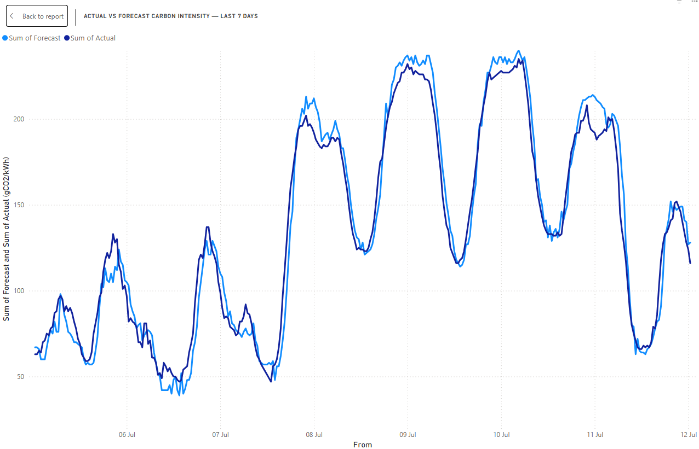
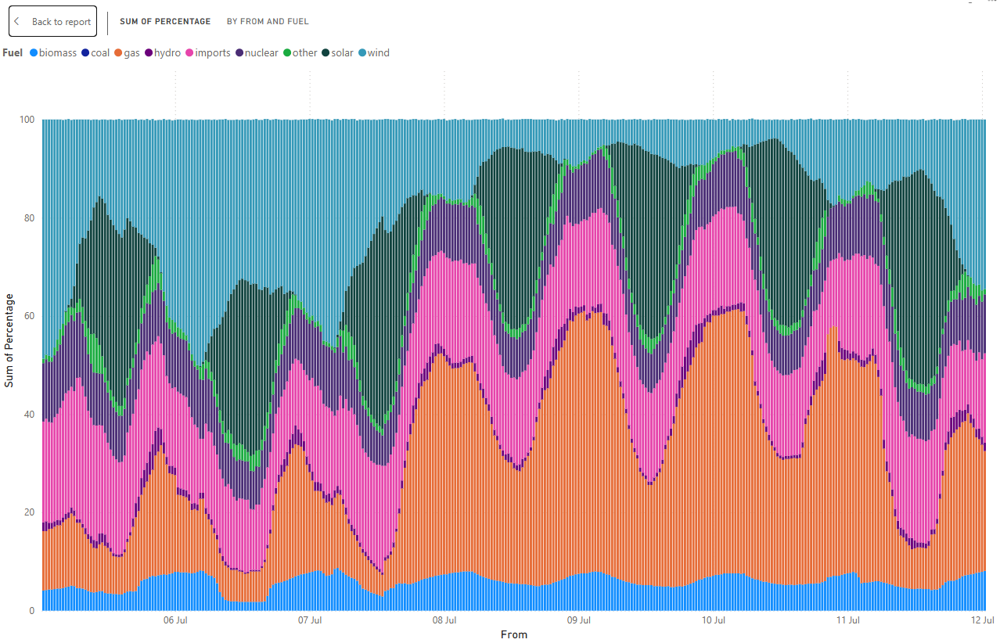

**What's in this analysis:**
- Actual vs Forecast carbon intensity (gCO2/kWh) over a fresh 7-day window
- Generation mix by fuel type over the same period
- A direct comparison against Week 1's findings, to check whether the 
  forecast bias was a one-off or a repeating pattern

**Files:**
- `ABA_CarbonIntensity.pbix` — Power BI file (updated for Week 2 dates)
- `screenshots/` — Week 2 chart images

**Key observation:** The time-of-day forecast bias identified in Week 1 
repeated in a fresh, independent week of data. Forecasts again ran too 
high overnight and too low during the afternoon peak — overnight average 
gap -6.8 gCO2/kWh, afternoon average +11.5 gCO2/kWh. Mean absolute error 
improved slightly (8.6 vs 10.3 gCO2/kWh in Week 1), but the directional 
pattern held. Two weeks in, this looks structural rather than random.


## Bonus: Match Night Demand (Elexon)

**Source:** [Elexon Insights Solution](https://bmrs.elexon.co.uk/) — 
Initial National Demand Outturn (INDO), live, public, no authentication 
required.

**What's in this analysis:**
- GB national demand (MW) across the evening of the England vs Norway 
  World Cup quarter-final, 11 July 2026

**Chart:**
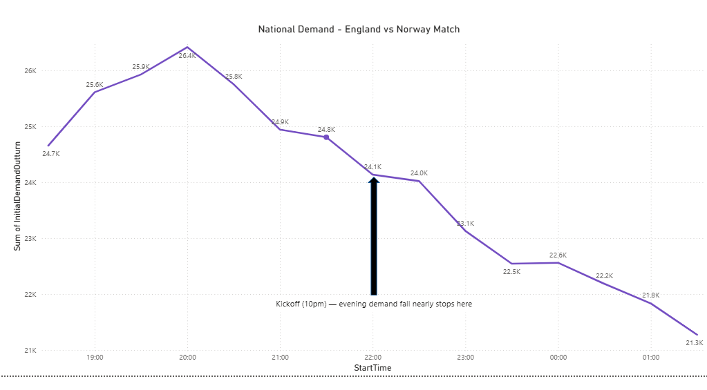

**Key observation:** Demand fell steadily through the evening as usual 
(600-900MW every half hour), but right at kickoff (10pm), the fall 
nearly stopped — just 116MW, the smallest drop of the night. A second 
check is planned around tonight's England vs Argentina semi-final to 
see if the pattern repeats.

## Week 3: Carbon Intensity — Pattern Evolving (National Grid ESO)

**Source:** [Carbon Intensity API](https://carbonintensity.org.uk/) — live, 
public, no authentication required.

**Charts:**
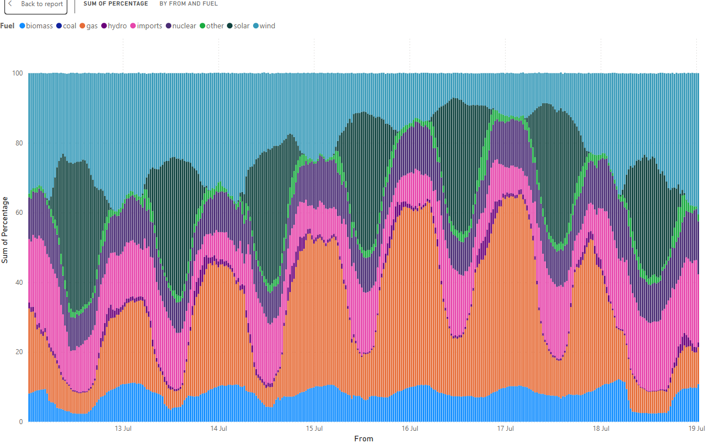
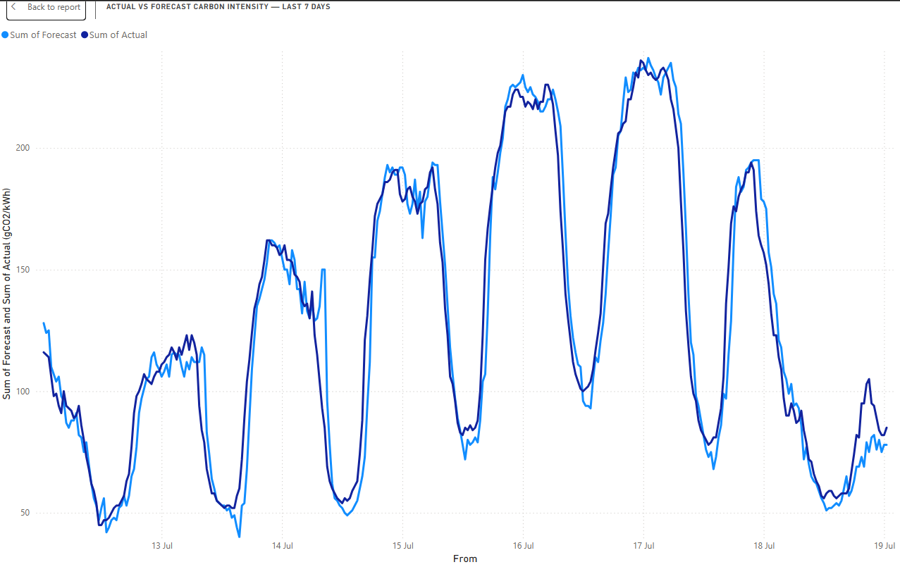

**What's in this analysis:**
- Actual vs Forecast carbon intensity (gCO2/kWh) over a third independent 
  7-day window
- Generation mix by fuel type over the same period
- A three-week comparison to check whether the forecast bias is stable 
  or shifting

**Files:**
- `ABA_CarbonIntensity.pbix` — Power BI file (updated for Week 3 dates)
- `screenshots/week3/` — Week 3 chart images

**Key observation:** The directional bias held for a third straight week 
(forecast too high overnight, too low in the afternoon), but its shape 
is shifting — the overnight gap has been shrinking each week (8-16 → 6.8 
avg → 3.4 avg gCO2/kWh), while the afternoon gap has been growing (11-19 
→ 11.5 avg → 17.1 avg gCO2/kWh). Mean absolute error stayed roughly 
stable at 9.4 gCO2/kWh. A notable new gap also appeared around 8-9am 
(-22.8 gCO2/kWh) — worth watching next week to see if it recurs.

## Roadmap
Future weeks will cover: NESO forecast accuracy, Elexon settlement data, 
DESNZ energy trends, and Ofgem data portal — each


## Week 4: Carbon Intensity — Four-Week Trend (National Grid ESO)

**Source:** [Carbon Intensity API](https://carbonintensity.org.uk/) — live, 
public, no authentication required.

**What's in this analysis:**
- Actual vs Forecast carbon intensity (gCO2/kWh) over a fourth 
  independent 7-day window
- Generation mix by fuel type over the same period
- A four-week trend comparison — enough data now to see a real trajectory, 
  not just repetition

- **Charts:**
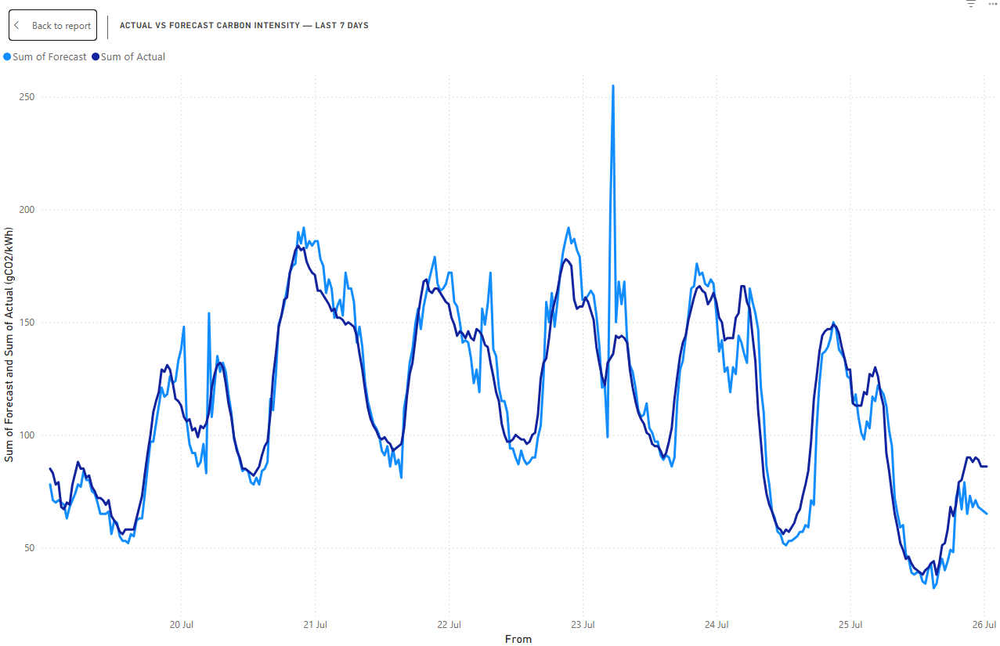
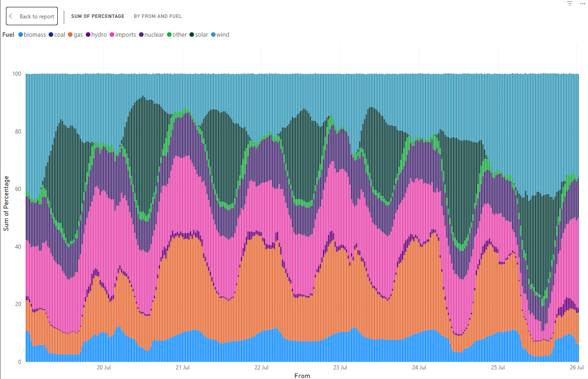

**Files:**
- `ABA_CarbonIntensity.pbix` — Power BI file (updated for Week 4 dates)
- `screenshots/week4/` — Week 4 chart images

## Week 5: Carbon Intensity — Trend Reversal (National Grid ESO)

**Source:** [Carbon Intensity API](https://carbonintensity.org.uk/) — live, 
public, no authentication required.

**What's in this analysis:**
- Actual vs Forecast carbon intensity (gCO2/kWh) over a fifth 
  independent 7-day window
- Generation mix by fuel type over the same period

**Files:**
- `ABA_CarbonIntensity.pbix` — Power BI file (updated for Week 5 dates)
- `screenshots/week5/` — Week 5 chart images

- **Charts:**
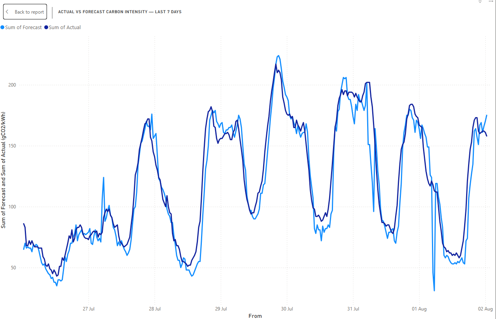
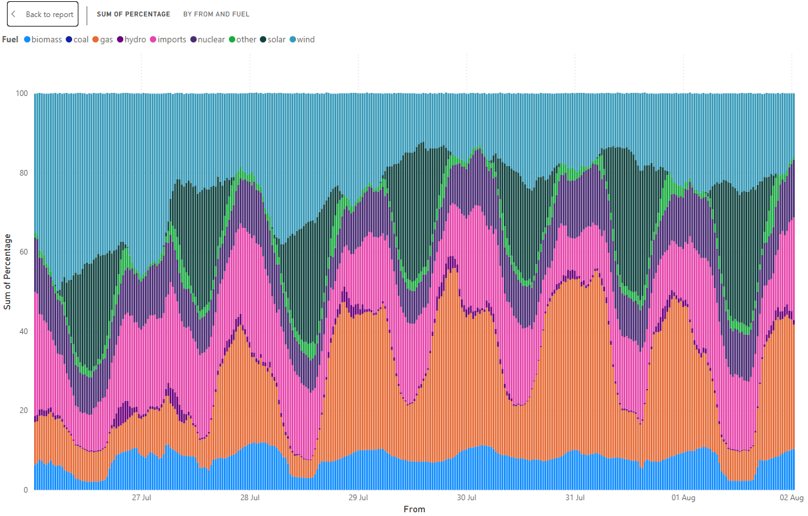

**Key observation:** After four straight weeks of the overnight bias 
shrinking toward zero, it crossed over this week — forecasts now run 
slightly too low overnight (+1.3 avg) rather than too high. Afternoon 
bias jumped to its highest point yet (+18.8), and mean absolute error 
rose to its weakest week so far (10.9). The four-week trend didn't hold 
as a straight line.


## Week 6: Carbon Intensity — Accuracy Declining (National Grid ESO)

**Source:** [Carbon Intensity API](https://carbonintensity.org.uk/) — live, 
public, no authentication required.

**What's in this analysis:**
- Actual vs Forecast carbon intensity (gCO2/kWh) over a sixth 
  independent 7-day window
- Generation mix by fuel type over the same period

**Files:**
- `ABA_CarbonIntensity.pbix` — Power BI file (updated for Week 6 dates)
- `screenshots/week6/` — Week 6 chart images

**Key observation:** MAE rose to 12.0 gCO2/kWh, the weakest week yet at 
that point. The overnight bias that flipped positive in Week 5 stayed 
positive (+2.3), confirming that shift wasn't a one-off. A sharp, brief 
drop in actual carbon intensity to near-zero was observed on 6 August 
around midday — flagged but not yet explained.

- **Charts:**
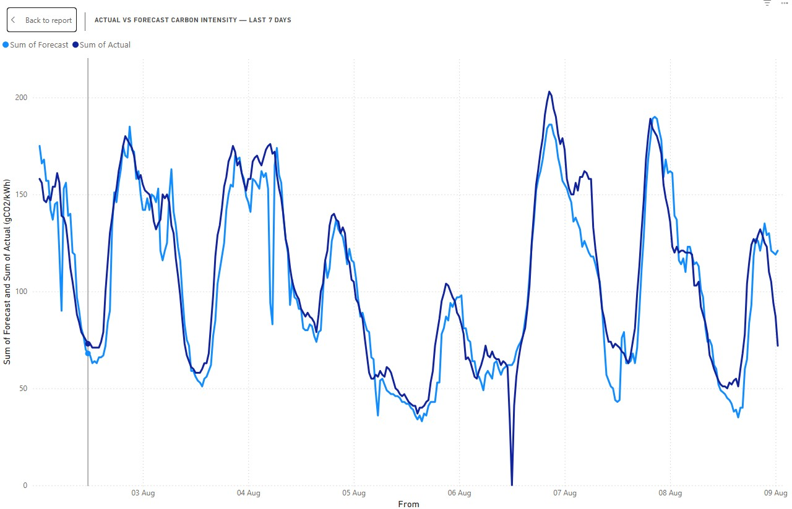
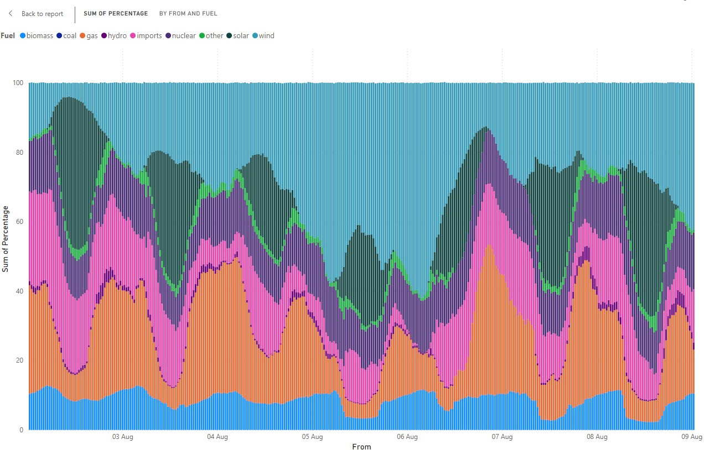


## Week 7: Carbon Intensity — Third Straight Week of Declining Accuracy

**Source:** [Carbon Intensity API](https://carbonintensity.org.uk/) — live, 
public, no authentication required.

**What's in this analysis:**
- Actual vs Forecast carbon intensity (gCO2/kWh) over a seventh 
  independent 7-day window
- Generation mix by fuel type over the same period

**Files:**
- `ABA_CarbonIntensity.pbix` — Power BI file (updated for Week 7 dates)
- `screenshots/week7/` — Week 7 chart images

- **Charts:**
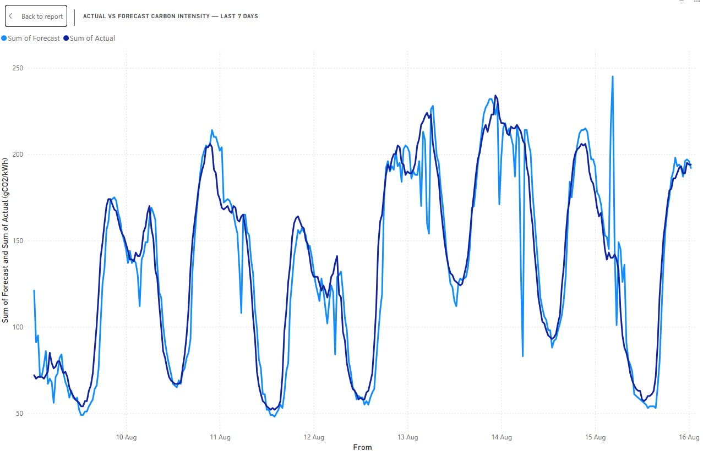
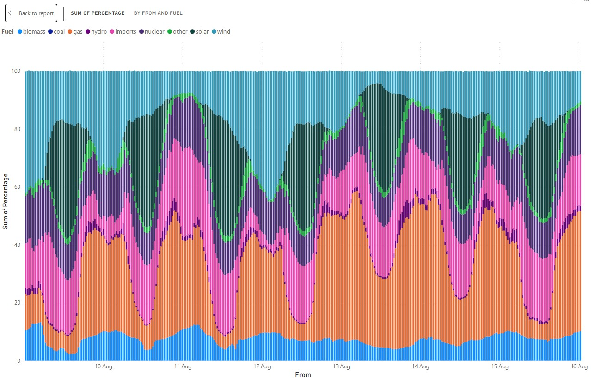

**Key observation:** MAE rose again to 12.2 gCO2/kWh — a third 
consecutive week of declining accuracy. Overnight bias has settled 
close to zero, but the afternoon bias hit its highest point of the 
whole tracker (+20.5), and the single largest error across all seven 
weeks occurred this week (125 gCO2/kWh at 5:30am, 14 August).

## Week 8: Carbon Intensity — Three-Week Decline Reverses (National Grid ESO)

**Source:** [Carbon Intensity API](https://carbonintensity.org.uk/) — live, 
public, no authentication required.

**What's in this analysis:**
- Actual vs Forecast carbon intensity (gCO2/kWh) over an eighth 
  independent 7-day window
- Generation mix by fuel type over the same period

**Files:**
- `ABA_CarbonIntensity.pbix` — Power BI file (updated for Week 8 dates)
- `screenshots/week8/` — Week 8 chart images

**Key observation:** After three consecutive weeks of declining accuracy 
(MAE 9.7 → 10.9 → 12.0 → 12.2), Week 8 reversed sharply — MAE dropped 
back to 10.0, near the middle of the whole tracker's range. Afternoon 
bias also pulled back (20.5 → 9.3). For a second consecutive week, one 
extreme single-point miss occurred (122 gCO2/kWh at 9:30pm on 22 
August) — cause unconfirmed, flagged as an open question rather than 
explained.

- **Charts:**
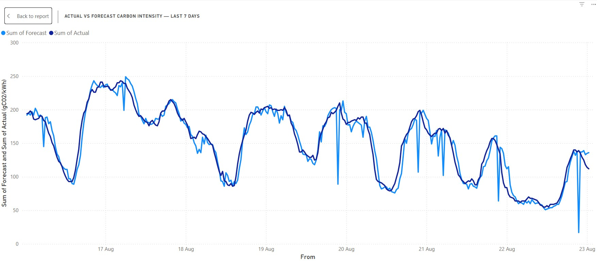
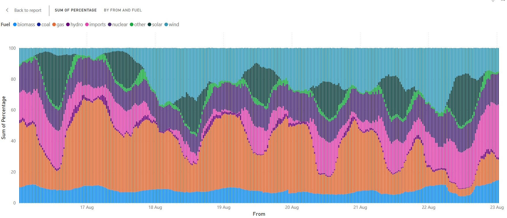

## Week 9: Carbon Intensity — Back to Normal Range (National Grid ESO)

**Source:** [Carbon Intensity API](https://carbonintensity.org.uk/) — live, 
public, no authentication required.

**What's in this analysis:**
- Actual vs Forecast carbon intensity (gCO2/kWh) over a ninth 
  independent 7-day window
- Generation mix by fuel type over the same period

**Files:**
- `ABA_CarbonIntensity.pbix` — Power BI file
- `screenshots/week9/` — Week 9 chart images

- **Charts:**


**Key observation:** MAE was 11.1 gCO2/kWh — within the normal range 
seen across the tracker so far, nothing unusual this week.

## Week 10: Carbon Intensity — Largest Anomaly of the Tracker

**Source:** [Carbon Intensity API](https://carbonintensity.org.uk/) — live, 
public, no authentication required.

**What's in this analysis:**
- Actual vs Forecast carbon intensity (gCO2/kWh) over a tenth 
  independent 7-day window
- Generation mix by fuel type over the same period

**Files:**
- `ABA_CarbonIntensity.pbix` — Power BI file (updated for Week 10 dates)
- `screenshots/week10/` — Week 10 chart images

- **Charts:**


**Key observation:** MAE more than doubled to 24.6 gCO2/kWh, the 
largest sustained gap of the whole tracker. 16% of all half-hour 
readings were off by more than 50 gCO2/kWh, clustered around early 
mornings on 31 August and 1-2 September, where actual intensity ran 
far lower than forecast. This is confirmed as a broad shift, not a 
single outlier — excluding the five biggest misses barely changes the 
average. Cause unconfirmed.


## Week 11: Carbon Intensity — Accuracy Improves After Week 10 Spike (National Grid ESO)

**Source:** [Carbon Intensity API](https://carbonintensity.org.uk/) — live, public, no authentication required.

**What's in this analysis:**
- Actual vs Forecast carbon intensity (gCO2/kWh) over an eleventh independent 7-day window
- Generation mix by fuel type over the same period
- Continued tracking of MAE and signed overnight (11pm–7am) and afternoon (3pm–5pm) forecast bias

**Key observation:** MAE fell to 15.9 gCO2/kWh after Week 10's exceptional 24.6 spike, but remained above the tracker's earlier normal range. Overnight bias was effectively neutral at +0.2 gCO2/kWh, while afternoon bias remained strongly positive at +21.6 gCO2/kWh, continuing the persistent afternoon under-forecast pattern.

## Week 12: Carbon Intensity — Back Within Normal Accuracy Range (National Grid ESO)

**Source:** [Carbon Intensity API](https://carbonintensity.org.uk/) — live, public, no authentication required.

**What's in this analysis:**
- Actual vs Forecast carbon intensity (gCO2/kWh) over a twelfth independent 7-day window
- Generation mix by fuel type over the same period
- Continued tracking of MAE and signed overnight and afternoon forecast bias

**Key observation:** MAE dropped to 9.3 gCO2/kWh, returning to the normal range seen across much of the tracker. Overnight bias remained small-positive at +1.3 gCO2/kWh and afternoon bias moderated to +10.9 gCO2/kWh. No obvious major anomaly was identified this week.

## Week 13: Carbon Intensity — Afternoon Bias Strengthens Again (National Grid ESO)

**Source:** [Carbon Intensity API](https://carbonintensity.org.uk/) — live, public, no authentication required.

**What's in this analysis:**
- Actual vs Forecast carbon intensity (gCO2/kWh) over a thirteenth independent 7-day window
- Generation mix by fuel type over the same period
- Continued tracking of MAE and signed overnight and afternoon forecast bias

**Key observation:** MAE rose moderately to 11.6 gCO2/kWh. Overnight bias remained small-positive at +2.3 gCO2/kWh, while afternoon bias strengthened again to +20.8 gCO2/kWh. Across Weeks 11–13, the overnight crossover to small-positive values persisted, while the afternoon under-forecast pattern remained pronounced in two of the three weeks.


## Weeks 14–17: Carbon Intensity — October Catch-up

Updated through **25 October 2026, 00:00 UTC** (end exclusive), using four complete, non-overlapping UTC weeks. Data were retrieved on 26 October 2026.

All errors below are in **gCO₂/kWh**. Signed bias is **actual minus forecast**: positive means under-forecasting; negative means over-forecasting.

| Week | UTC window (end exclusive) | Valid periods | MAE | Overnight bias | Afternoon bias |
| --- | --- | ---: | ---: | ---: | ---: |
| 14 | 2026-09-27 → 2026-10-04 | 336 | 13.8 | +7.7 | +10.9 |
| 15 | 2026-10-04 → 2026-10-11 | 336 | 10.2 | +4.6 | +10.4 |
| 16 | 2026-10-11 → 2026-10-18 | 336 | 10.2 | +6.6 | +11.3 |
| 17 | 2026-10-18 → 2026-10-25 | 336 | 9.7 | +7.1 | +10.0 |

**Key observation:** MAE improved from 13.8 in Week 14 to 9.7 in Week 17. Afternoon bias stayed positive in all four new weeks (+10.0 to +11.3), indicating repeated under-forecasting within this UTC band. Overnight bias was also positive (+4.6 to +7.7). These observations do not identify the cause of the errors.

### Reproducible methodology

- Use interval **start** timestamps, UTC, with each week defined as `[start, end)`. The API also returns a period ending at the requested start; this is excluded to prevent overlap.
- Weekly MAE is the mean of `abs(actual − forecast)` over 336 half-hourly periods. Missing values, missing periods and duplicate start timestamps cause the script to stop.
- Overnight bias averages signed half-hourly errors with start hours `{23, 0, 1, 2, 3, 4, 5, 6, 7}`; afternoon bias uses `{15, 16, 17}`. These mean 23:00–08:00 and 15:00–18:00 UTC; they are not UK local-time bands.
- **Historical comparability:** re-fetching Week 13 reproduced its published MAE (11.6), but gave overnight +1.2 and afternoon +15.2 using the calculation above, versus the previously published +2.3 and +20.8. The original calculation script is absent from this repository; the reason for the difference is unresolved. Historical figures are preserved. Do not infer a like-for-like change in band bias from Weeks 1–13 to Weeks 14–17 until that discrepancy is reconciled.
- Historical API `forecast` values are analysed as returned at retrieval. This does not establish a fixed forecast lead time or preserve forecast revisions. Generation mix is descriptive; no causal attribution is made.

### Data and reproduction

Run with Python 3 (standard library only):

```bash
python scripts/update_carbon_intensity.py --start 2026-09-27 --weeks 4 --first-week 14
```

Each `data/weekN/` folder contains forecast/actual and generation CSVs, raw API JSON, and source URLs with retrieval time. The summary is in [`data/weekly_summary.csv`](data/weekly_summary.csv). Re-fetching later may reflect API revisions. The Power BI `.pbix` file has not been refreshed in this update.

### Week 14

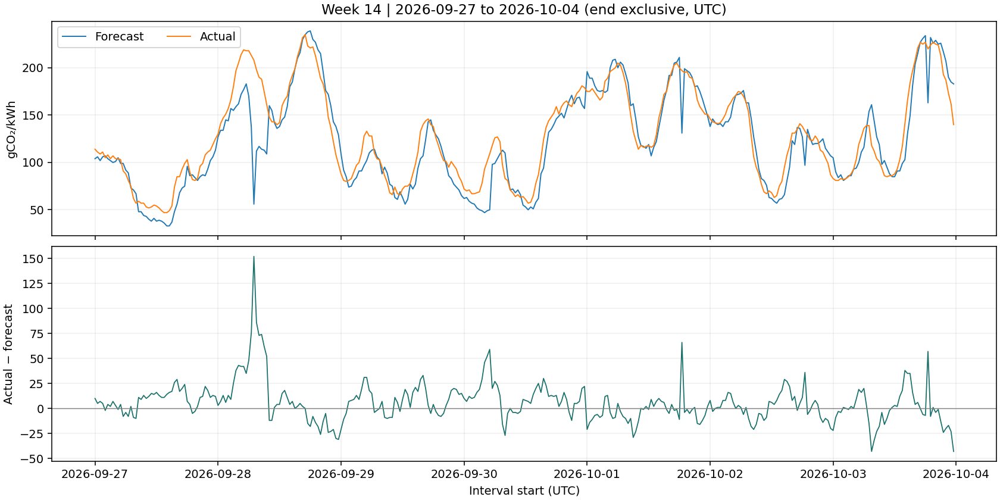

### Week 15

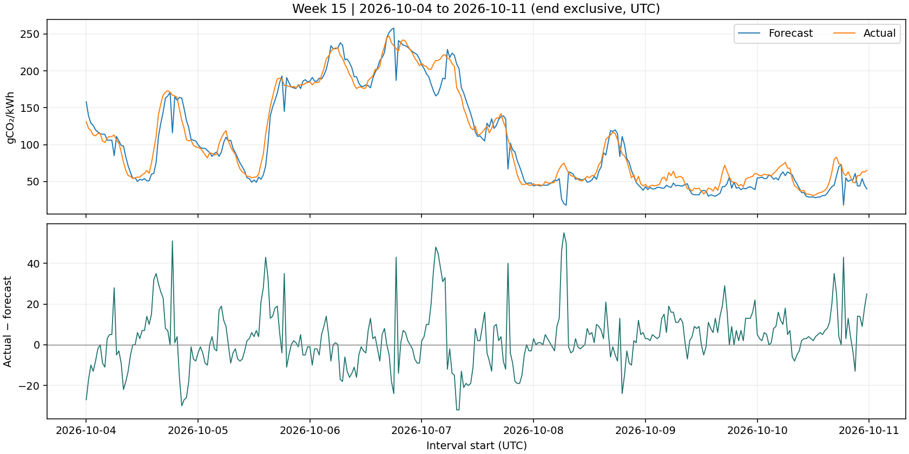

### Week 16

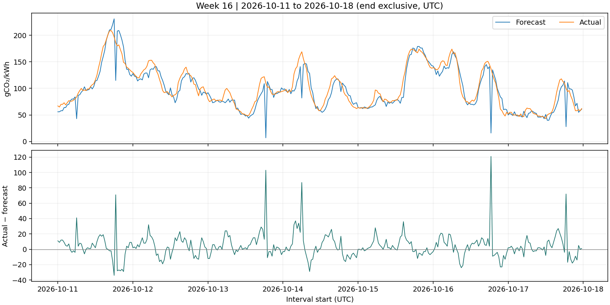

### Week 17

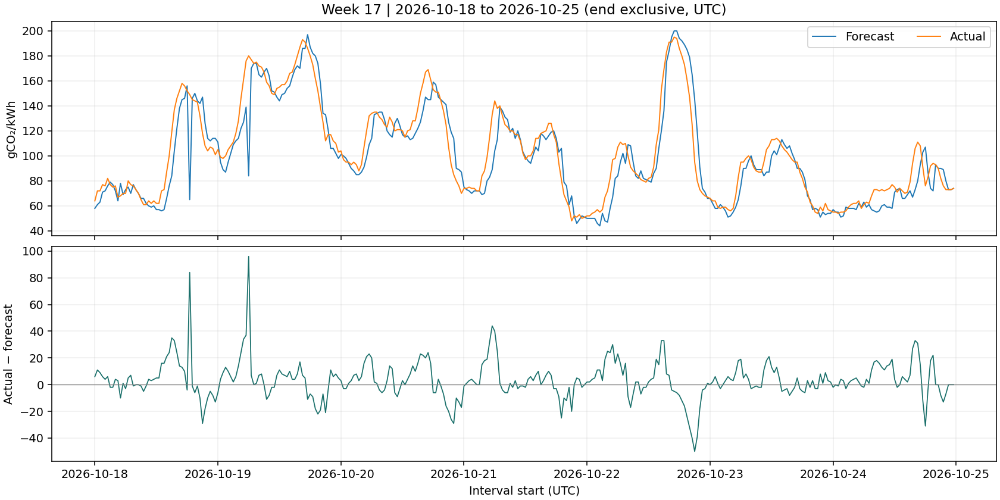

## Week 18: Carbon Intensity — Weekly Update

**Window:** 25 October–1 November 2026, 00:00 UTC (end exclusive). Retrieved 3 November 2026. All 336 half-hourly forecast/actual and generation observations are present.

| MAE | Overnight bias | Afternoon bias | Largest absolute error | Errors above 50 |
| ---: | ---: | ---: | ---: | ---: |
| 8.5 | +2.0 | +14.3 | 44 | 0 / 336 |

All error values are in gCO₂/kWh. Signed bias is actual minus forecast. UTC interval-start bands match Weeks 14–17: overnight hours {23,0–7} and afternoon hours {15,16,17}. This week includes the UK clock change; the analysis uses a fixed UTC week and UTC bands throughout.

**Key observation:** Weekly MAE was 8.5, compared with 9.7 in Week 17. Afternoon bias was +14.3; overnight bias was +2.0. Positive bias indicates under-forecasting; negative bias indicates over-forecasting. The data do not establish a cause or a fixed forecast lead time.

[Source observations and raw API responses](data/week18/) · [Weekly summary](data/weekly_summary.csv)

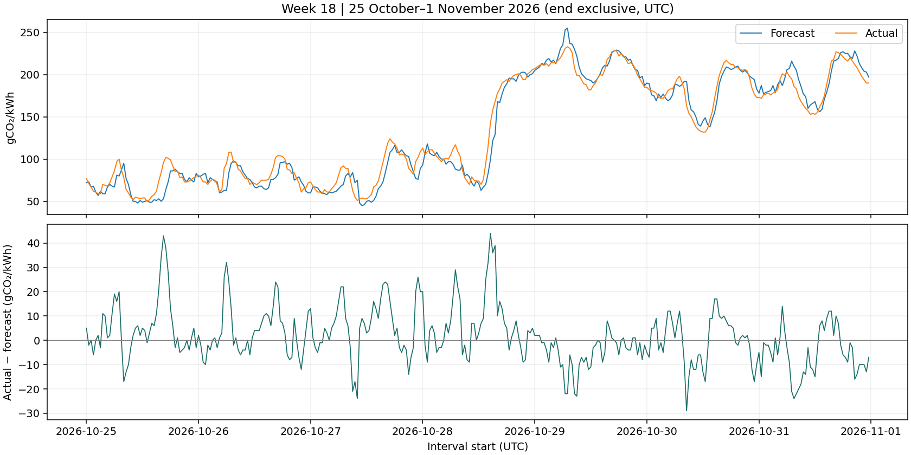
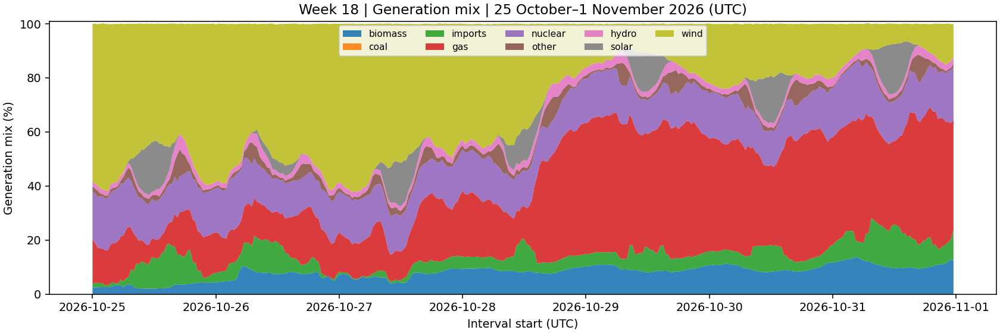

Reproduce with `python scripts/update_carbon_intensity.py --start 2026-10-25 --weeks 1 --first-week 18`. The script now preserves earlier summary rows when updating an individual week. The historical comparability note above continues to apply. The Power BI file has not been refreshed as part of this update.

## Week 19: Carbon Intensity — Weekly Update

**Window** — 1 November 2026, 00:00 UTC to 8 November 2026, 00:00 UTC (end exclusive). Retrieved 12 November 2026. The forecast/actual and generation files each contain 336 half-hourly periods.

| MAE | Mean signed error | Overnight bias | Afternoon bias | Largest absolute error | Errors above 50 |
| ---: | ---: | ---: | ---: | ---: | ---: |
| 6.4464 | −0.5714 | +1.7063 | −0.3333 | 43 | 0 / 336 |

Errors are in gCO₂/kWh. Signed error is actual minus forecast, using the same UTC bands as Weeks 14–18.

Afternoon bias was close to zero after five weeks of positive bias (+10.05 to +14.31). Afternoon MAE fell from 14.69 in Week 18 to 5.76 in Week 19. Week 19 had 18 positive, 21 negative and 3 zero afternoon errors across 42 periods. Weekly MAE was the lowest in Weeks 14–19, and this was the second consecutive week with zero absolute errors above 50. Persistence requires further comparable weeks.

[Half-hourly forecast and actuals](data/week19/intensity.csv) · [Generation mix](data/week19/generation.csv) · [Raw API responses and provenance](data/week19/) · [Weekly summary](data/weekly_summary.csv)

Re-fetch and recalculate with `python scripts/update_carbon_intensity.py --start 2026-11-01 --weeks 1 --first-week 19`. Use the committed CSVs and raw responses to audit this snapshot, since later API retrievals may include revisions. The historical Weeks 1–13 comparability caveat above still applies.

## Week 20: Carbon Intensity — Weekly Update

**Window:** 8–15 November 2026, 00:00 UTC (end exclusive). Retrieved 19 November 2026. All 336 half-hourly forecast/actual and generation observations are present.

| MAE | Mean signed error | Overnight bias | Afternoon bias | Largest absolute error | Errors above 50 |
| ---: | ---: | ---: | ---: | ---: | ---: | ---: |
| 6.64 | −2.20 | −0.65 | −1.88 | 42 | 0 / 336 |

Errors are in gCO₂/kWh; signed error is actual minus forecast, using the same UTC bands as Weeks 14–19. MAE rose slightly from 6.45 in Week 19 but remained below Weeks 14–18. Afternoon bias remained negative for a second consecutive week, following five weeks of positive bias. This is the third consecutive week with no absolute errors above 50. These observations do not establish a cause or a permanent change.

[Half-hourly forecast and actuals](data/week20/intensity.csv) · [Generation mix](data/week20/generation.csv) · [Raw API responses and provenance](data/week20/) · [Weekly summary](data/weekly_summary.csv)

Reproduce with `python scripts/update_carbon_intensity.py --start 2026-11-08 --weeks 1 --first-week 20`. Historical comparability caveats continue to apply. The Power BI file has not been refreshed in this update.

## Findings Log
- **Week 1 (27 Jun–4 Jul):** Forecast carried a systematic time-of-day 
  bias — too high overnight (11pm-7am, by 8-16 gCO2/kWh), too low during 
  the afternoon peak (3-5pm, by 11-19 gCO2/kWh). Mean absolute error: 
  10.3 gCO2/kWh.
- **Week 2 (5-12 Jul):** Same directional bias repeated — overnight too 
  high (avg -6.8), afternoon too low (avg +11.5). Mean absolute error 
  improved slightly to 8.6 gCO2/kWh. Two weeks in, the pattern looks 
  structural rather than random.
- **Week 3 (12-19 Jul):** Directional bias held for a third week, but 
  shape is shifting — overnight gap shrinking (was -16, now -3.4 avg), 
  afternoon gap growing (was +19, now +17.1 avg). MAE roughly stable at 
  9.4 gCO2/kWh.
- **Week 4 (19-26 Jul):** Overnight bias shrunk for a fourth consecutive 
  week (-2.3 avg) — clear trend. Afternoon bias reversed course, pulling 
  back to +8.5 after two weeks of growth. Week 3's 8-9am anomaly did not 
  repeat at scale. MAE stable at 9.7, consistent with prior weeks.
- **Week 5 (26 Jul-2 Aug):** Overnight bias crossed zero (+1.3), reversing the four-week shrinking trend. Afternoon bias hit its highest point at that stage (+18.8). MAE rose to 10.9.
- **Week 6 (2-9 Aug):** MAE rose to 12.0, weakest week yet at that point.
  Overnight bias stayed positive (+2.3), confirming Week 5's reversal 
  wasn't a one-off. Unexplained near-zero intensity dip observed 6 Aug.
- **Week 7 (9-16 Aug):** MAE rose again to 12.2 — third straight week of 
  declining accuracy. Overnight bias settled near zero; afternoon bias 
  hit its highest point yet (+20.5). Largest single error of the 
  tracker so far (125 gCO2/kWh).
- **Week 8 (16-23 Aug):** Three-week decline in accuracy reversed — MAE 
  dropped to 10.0, afternoon bias pulled back to 9.3. Second consecutive 
  week with one large unexplained single-point miss (122 gCO2/kWh).
- **Week 9 (23-30 Aug):** MAE 11.1, within normal range.
- **Week 10 (30 Aug-6 Sep):** MAE spiked to 24.6, the largest anomaly 
  of the tracker — 16% of readings off by 50+ gCO2/kWh, clustered on 
  31 Aug and 1-2 Sep mornings. Confirmed as a broad shift, not an 
  outlier artifact. Cause unconfirmed.

- **Week 11 (6-13 Sep):** MAE improved to 15.9 after Week 10's spike but remained elevated. Overnight bias was near-neutral (+0.2); afternoon bias remained strongly positive (+21.6).
- **Week 12 (13-20 Sep):** MAE returned to 9.3, within the tracker's normal range. Overnight bias stayed small-positive (+1.3) and afternoon bias moderated to +10.9.
- **Week 13 (20-27 Sep):** MAE rose to 11.6. Overnight bias remained small-positive (+2.3), while afternoon bias strengthened again to +20.8. Across Weeks 11-13, the overnight crossover held and the persistent afternoon under-forecast pattern remained intact.

- **Week 14 (2026-09-27 to 2026-10-04, UTC end exclusive)** — MAE 13.81, overnight bias +7.74 and afternoon bias +10.90 gCO₂/kWh. Complete 336-period week, with 11 absolute errors above 50.
- **Week 15 (2026-10-04 to 2026-10-11, UTC end exclusive)** — MAE 10.22, overnight bias +4.63 and afternoon bias +10.43 gCO₂/kWh. Complete 336-period week, with 2 absolute errors above 50.
- **Week 16 (2026-10-11 to 2026-10-18, UTC end exclusive)** — MAE 10.23, overnight bias +6.58 and afternoon bias +11.29 gCO₂/kWh. Complete 336-period week, with 5 absolute errors above 50.
- **Week 17 (2026-10-18 to 2026-10-25, UTC end exclusive)** — MAE 9.74, overnight bias +7.10 and afternoon bias +10.05 gCO₂/kWh. Complete 336-period week, with 2 absolute errors above 50.
- **Week 18 (25 Oct–1 Nov, UTC end exclusive):** MAE 8.5; overnight bias +2.0; afternoon bias +14.3. Complete 336-period week.
- **Week 19 (1–8 Nov, UTC end exclusive)** — MAE 6.4464, overnight bias +1.7063 and afternoon bias −0.3333. Across 336 periods, the largest absolute error was 43 and none exceeded 50. Afternoon MAE was 5.76 versus 14.69 in Week 18. The duration of the change is unknown.
- **Week 20 (8–15 Nov, UTC end exclusive):** MAE 6.64; overnight bias −0.65; afternoon bias −1.88. No absolute errors above 50 for the third consecutive week.
